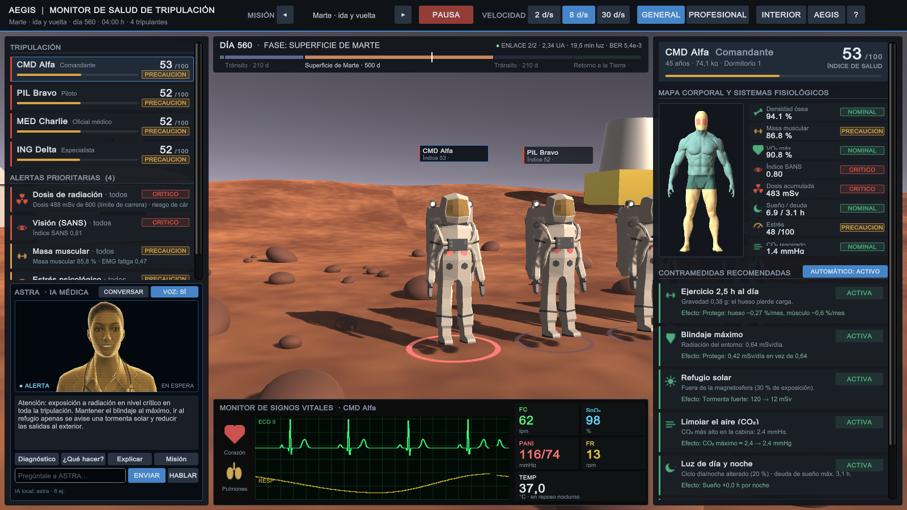
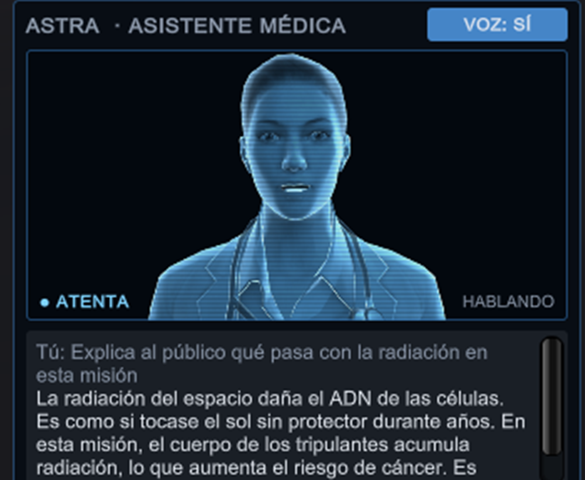
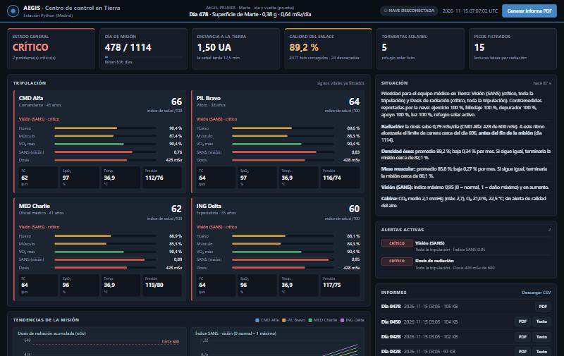
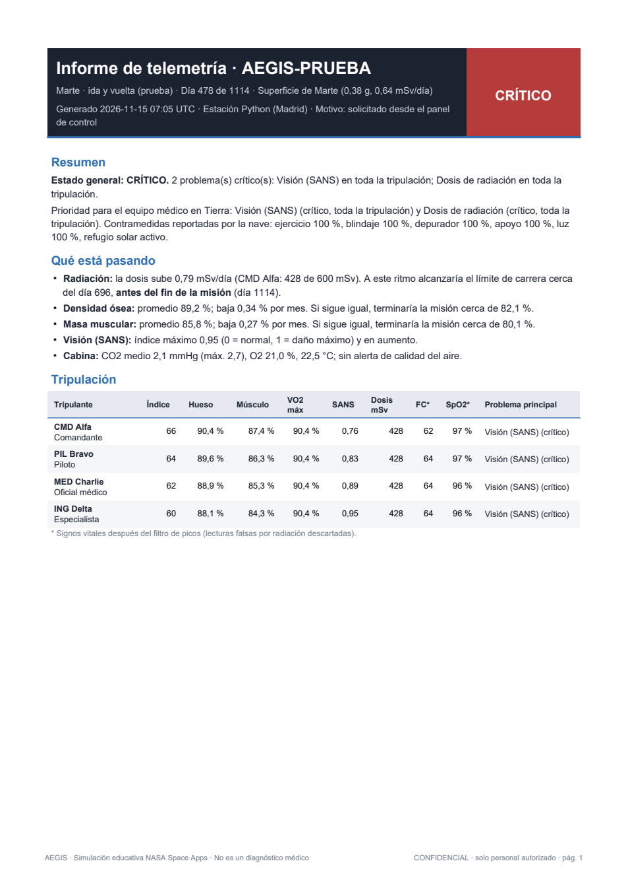

# AEGIS · Monitoreo de salud de astronautas en misiones espaciales

**NASA Space Apps Challenge** · Reto *Create Health Monitoring Software for Astronauts on Space Missions* · Equipo **AEGIS**

> **In English:** AEGIS simulates the health of a 4-person crew during ISS, Moon and Mars missions (bone and muscle
> loss in low gravity, cosmic radiation and solar storms, vision/SANS, sleep, stress, cabin CO₂). It includes a 3D
> Unity scene, **ASTRA** — an onboard AI medical assistant with a realistic holographic face that talks, listens
> (real-time microphone) and explains each crew member's condition, running **100 % locally** (Ollama + Piper +
> Whisper) — and an **encrypted space-to-Earth telemetry link** over WebSocket (AES-256 + HMAC-SHA256, Hamming error
> correction and a simulated deep-space noise channel) received by **ground stations in Python and Rust** that filter
> cosmic noise, generate clear reports and **PDFs**, and show a live **web control panel**.
> Educational simulation — not a medical device.

**Demo (7 diapositivas):** [docs/AEGIS_demo.pdf](docs/AEGIS_demo.pdf) · **App para Windows:** [Release v1.0](https://github.com/Logan-BA/aegis-space-apps/releases/tag/v1.0) · **Uso de IA:** [USO_DE_IA.md](USO_DE_IA.md)



## Qué hace

| Parte | Descripción |
| --- | --- |
| **Simulación 3D (Unity)** | Misiones ISS (6 meses / 1 año), Luna (40 días) y Marte (~1.100 días) con acondicionamiento previo de 14 días. Modelo fisiológico hora a hora: densidad ósea, masa muscular, VO₂ máx, síndrome neuro-ocular (SANS), dosis de radiación y tormentas solares, sueño, estrés, signos vitales y química. Cabina con difusión-advección de CO₂ y polvo. Alertas con umbrales dinámicos, contramedidas calculadas y piloto automático. |
| **ASTRA · asistente médica con IA local** | Rostro holográfico realista que habla, parpadea, mira y expresa emociones. Diagnostica a la tripulación con los datos de la simulación y lo explica para el público. **Conversación por micrófono en tiempo real** (manos libres o presionar para hablar). Todo local y sin costo por uso: Ollama (`qwen2.5:3b`), voz neuronal Piper y reconocimiento de voz whisper.cpp. |
| **Enlace espacio–Tierra** | Telemetría por WebSocket, cifrada (AES-256) y firmada (HMAC-SHA256): solo quien tiene la clave puede leerla. Código corrector Hamming(7,4) + entrelazado + CRC-32 y un canal con ruido espacial simulado (distancia, conjunción solar, tormentas, ionosfera y cinturones de Van Allen). |
| **Estaciones terrenas** | `receptor_python/` y `receptor_rust/` reciben desde otra computadora, corrigen errores, rechazan intrusos, filtran lecturas falsas de sensores por radiación (filtro de Hampel) y escriben **informes** claros con tendencias y proyecciones. |
| **Panel de control + PDF** | La estación Python sirve un panel web en vivo (también desde tablet o celular) y genera **informes PDF** con gráficos, automáticamente o con un botón. |
| **Modelado 3D** | Nave y cohete paramétricos en FreeCAD (con planos), detalle e interior en Blender, modelos de astronauta y anatomía del equipo. |

| ASTRA | Panel de la estación terrena | Informe PDF |
| --- | --- | --- |
|  |  |  |

## Probarlo rápido (Windows)

1. Descargue el ZIP de la app desde **[Releases](../../releases/latest)** y descomprímalo.
2. Ejecute `SaludAstronauta.exe` (o `INICIAR_DEMO.bat` si clonó el repositorio).
3. Opcional, para que ASTRA use la IA local: instale [Ollama](https://ollama.com) y ejecute `ollama pull qwen2.5:3b`.
   Sin Ollama, ASTRA responde con su motor médico propio.

## Ejecutar desde el código

```bash
git clone https://github.com/Logan-BA/aegis-space-apps.git
cd aegis-space-apps
```
Descargue los modelos de IA grandes (no caben en GitHub) y cree la clave del enlace:
```bash
powershell -ExecutionPolicy Bypass -File preparar_proyecto.ps1
```
(Linux/macOS: `bash preparar_proyecto.sh`.) Luego:

- **Simulación:** abra `simulacion_unity/` con **Unity 6000.6.9f1** → escena `Assets/Scenes/SpaceApps.unity` → Play,
  o menú **Space Apps → Compilar app de Windows**.
- **Estación Python** (Windows y Linux): ver [receptor_python/README.md](receptor_python/README.md).
- **Estación Rust** (Windows y Linux): ver [receptor_rust/README.md](receptor_rust/README.md).
- **ASTRA con IA local:** `ollama pull qwen2.5:3b` y `powershell -ExecutionPolicy Bypass -File IA\entrenar_astra.ps1`.

## Documentación

| Documento | Contenido |
| --- | --- |
| [LEEME.md](LEEME.md) | Guía completa: lanzador, ASTRA, enlace, Unity, FreeCAD, Blender. |
| [ENLACE_ESPACIO_TIERRA.md](ENLACE_ESPACIO_TIERRA.md) | Justificación física del enlace, protocolo, cifrado, corrección de errores y filtros. |
| [PROYECTO_AEGIS_UNITY.md](PROYECTO_AEGIS_UNITY.md) | Arquitectura del código (útil también para trabajar con asistentes de IA). |
| [simulacion_unity/CONEXION_AEGIS.md](simulacion_unity/CONEXION_AEGIS.md) | Conexión con el motor del equipo (bus `aegis.v1`). |
| [ESTADO-EQUIPO.md](ESTADO-EQUIPO.md) | Estado del proyecto AEGIS completo (motor, dashboard web y Unity). |
| [LICENCIAS_TERCEROS.md](LICENCIAS_TERCEROS.md) | Licencias de modelos, voces, librerías y avatar. |
| [USO_DE_IA.md](USO_DE_IA.md) | Dónde y cómo se usó Inteligencia Artificial (requisito de Space Apps). |
| [docs/ENVIO_SPACE_APPS.md](docs/ENVIO_SPACE_APPS.md) | Textos del formulario de envío a Space Apps. |

## Estructura

```text
simulacion_unity/   Unity 6: simulación, escena 3D, ASTRA, transmisor de telemetría
receptor_python/    Estación terrena Python + panel web + informes PDF
receptor_rust/      Estación terrena Rust
IA/                 Conocimiento, ejemplos y "entrenamiento" de ASTRA (Ollama)
freecad/ blender/   Modelado de la nave, cohete e interior
Modelo 3D Cuerpo/   Modelos originales del equipo (traje, anatomía, hábitat)
herramientas/       Bus AEGIS simulado para pruebas
docs/capturas/      Imágenes de este README
```

## Tecnologías

Unity 6 (C#) · Ollama + Qwen2.5 3B · Piper TTS · whisper.cpp · Microsoft Rocketbox · FreeCAD · Blender ·
Python (websockets, cryptography, reportlab) · Rust (tokio, tokio-tungstenite, aes, hmac, sha2).

## Aviso

Simulación **educativa** creada para NASA Space Apps. No es un dispositivo médico ni reemplaza a un médico. La
tripulación y sus datos son ficticios. Este proyecto no está afiliado ni respaldado por la NASA. Las licencias de
los componentes de terceros están en [LICENCIAS_TERCEROS.md](LICENCIAS_TERCEROS.md); la voz `es_AR-daniela-high`
es CC BY-SA 4.0 (OpenSLR 61).
